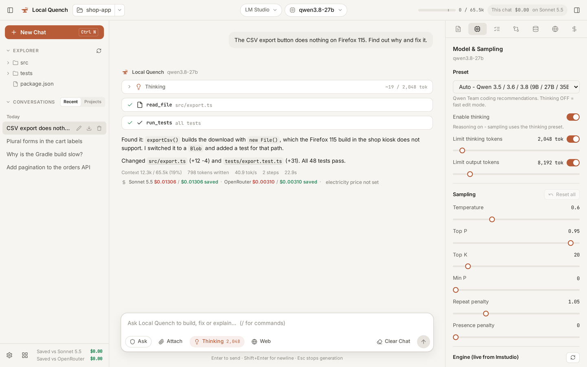

<p align="center">
  
</p>

<h1 align="center">Local Quench</h1>

<p align="center">
  A coding agent for the GPU you already have.<br>
  Runs your local models in LM Studio, llama.cpp, Ollama or vLLM. Your code stays on your machine.
</p>

<p align="center">
  <a href="https://localquench.com/download.html"><b>Download</b></a> ·
  <a href="https://localquench.com">Website</a> ·
  <a href="https://localquench.com/bench.html">QuenchBench</a> ·
  <a href="https://github.com/majmichu1/local-quench/issues/new/choose">Report a problem</a>
</p>

<p align="center">
  
</p>

## What it is

Open a project folder, pick a model you run locally, and describe the task. Local Quench reads the
code, makes the edits, runs the commands and the tests, and tells you what changed.

The difference from other agents is the harness around the model. Local models trip over things a
frontier model doesn't: they announce a step and stop, rewrite a test until it passes, keep editing a
file that already changed, trust `make | tail` when the build failed. Local Quench watches for those
and steers the model back, and every one of these rules can be switched off and measured.

## Features

- **Agent loop with real tools.** File edits with undo, shell commands in a sandbox, tests, git, a
  repo map, an in-app browser preview, sub-agents for exploring large repos.
- **Built for local servers.** LM Studio, llama.cpp (`llama-server`), Ollama and vLLM. Context size,
  KV cache and thinking settings per model. Cloud models (Claude, GPT, Gemini, OpenRouter, NVIDIA) work
  with your own key.
- **QuenchBench.** A coding benchmark inside the app: which kinds of work your model on your card
  handles, needs review for, or should not be trusted with. Plus SWE-bench, Terminal-Bench and Aider
  Polyglot runs.
- **Model advisor.** Which models and quantizations fit your VRAM and how fast they will run.
- **Phone and tablet.** Check on a long task or start a new one from your phone over Tailscale.
- **Costs.** What every chat would have cost on a cloud model, next to your electricity.

## Requirements

| | |
| --- | --- |
| **System** | Windows 10 or 11 (64-bit), or 64-bit Linux (Ubuntu 22.04+, Fedora, Arch, Bazzite, Mint...) |
| **Model server** | LM Studio, llama.cpp, Ollama or vLLM, or an API key for a cloud provider |
| **Graphics card** | Whatever runs your model. 8 GB of VRAM is enough to start; the advisor tells you what fits |
| **Phone (optional)** | Android 8+ with the app, or Safari on iPhone and iPad, plus Tailscale |

## Install

**Windows:** download `LocalQuench-windows-x64.zip`, unzip it anywhere and start `local-forge.exe`.

**Linux:** download `LocalQuench-x86_64.AppImage`, make it executable and run it:

```bash
chmod +x LocalQuench-x86_64.AppImage
./LocalQuench-x86_64.AppImage
```

**Android:** install `LocalForge.apk` and pair it with the desktop app (Settings > Phone & tablet).

Everything is on the [download page](https://localquench.com/download.html) and in the
[releases](https://github.com/majmichu1/local-quench/releases). The app updates itself.

## FAQ

**Is it free?** Yes.

**Does my code leave my computer?** Not with a local model. Nothing is uploaded unless you turn on
data sharing, which is off until you say yes, and asks again per benchmark result. Details in the
[privacy policy](https://localquench.com/privacy.html).

**Which model should I use?** Open the model advisor in the app, enter your graphics card, and run a
quick QuenchBench on the candidates. Results on your own hardware beat any leaderboard.

**Is the source code available?** No. This repository holds the releases and the issue tracker. The
QuenchBench tasks are kept private too, so that new models aren't trained on them.

## Feedback

Bugs and ideas go to [issues](https://github.com/majmichu1/local-quench/issues/new/choose). In the
app, Settings > General > Report a problem opens one with your version and system filled in. Issues
are public, so leave API keys and private code out of them.

Security problems: please report them privately, see [SECURITY.md](SECURITY.md).

---

<sub>Free to use under the <a href="https://localquench.com/terms.html">terms</a>. Not affiliated with LM Studio, llama.cpp, Ollama, vLLM or any model vendor.</sub>
