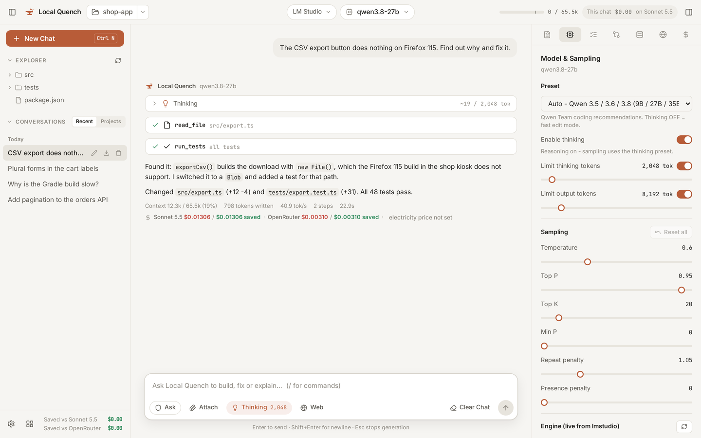

<p align="center">
  
</p>

<h1 align="center">Local Quench</h1>

<p align="center">
  An AI coding agent for local LLMs, on the GPU you already have.<br>
  Runs your local models itself with a built-in llama.cpp engine, or through LM Studio, Ollama or vLLM. Your code stays on your machine.<br>
  Windows, Linux and Mac (beta). Android, iPhone and iPad as a remote.
</p>

<p align="center">
  <a href="https://localquench.com/download.html"><b>Download</b></a> ·
  <a href="https://localquench.com">Website</a> ·
  <a href="#benchmark-your-model-from-the-command-line">Run the benchmark</a> ·
  <a href="https://localquench.com/bench.html">QuenchBench</a> ·
  <a href="https://github.com/majmichu1/local-quench/issues/new/choose">Report a problem</a>
</p>

<p align="center">
  
</p>

## In this repository

- **Local Quench**, the app: builds for Windows, Linux, Mac (beta) and Android in
  [Releases](https://github.com/majmichu1/local-quench/releases).
- **[`quenchbench.py`](quenchbench.py)**, a benchmark runner: measure any local model (or cloud API) on
  QuenchBench, SWE-bench Verified, SWE-bench Multilingual, Terminal-Bench 2.0 or Aider Polyglot with
  one command. [How to run it](#benchmark-your-model-from-the-command-line).
- [`quenchbench-sample/`](quenchbench-sample/): 26 QuenchBench tasks (two per section, from the dev split) with their
  hidden checks and reference solutions, and `verify.py` to check them yourself: each starting project fails its
  checks and each reference solution passes them. The held-out tasks used for the final measurement stay private.
- [`docs/bridge.md`](docs/bridge.md) and [`docs/advisor.md`](docs/advisor.md): how Agent Bridge (Claude Code hands a task to your
  local model) and Ask a Bigger Model (your local model asks a stronger one for advice) work.
- [`docs/harness-comparison-2026-11.md`](docs/harness-comparison-2026-11.md): a first comparison of Local Quench and
  pi on QuenchBench Short with the same local model ([summary below](#first-harness-comparison-local-quench-and-pi)).
- [`docs/FEATURES.md`](docs/FEATURES.md): every tool, every harness behaviour and the ablation switches
  that turn them off, to read QuenchBench results by.
- The [issue tracker](https://github.com/majmichu1/local-quench/issues) for both, and
  [`models.json`](models.json), the model list behind the leaderboard and the model advisor.

## What it is

Open a project folder, pick a model you run locally, and describe the task. Local Quench reads the
code, makes the edits, runs the commands and the tests, and tells you what changed.

The difference from other agents is the harness around the model. Local models trip over things a
frontier model doesn't: they announce a step and stop, rewrite a test until it passes, keep editing a
file that already changed, trust `make | tail` when the build failed. Local Quench watches for those
and steers the model back, and every one of these rules can be switched off and measured.

## Features

- **Agent loop with real tools.** File edits with undo, shell commands (in a sandbox on Linux), tests, git, a
  repo map, an in-app browser preview, sub-agents for exploring large repos.
- **Runs the model itself.** Pick a model: Local Quench downloads it, runs it with its built-in llama.cpp engine and
  says plainly what fits your computer. LM Studio, llama.cpp (`llama-server`), Ollama and vLLM work too. Context size,
  KV cache and thinking settings per model. Cloud models (Claude, GPT, Gemini, OpenRouter, NVIDIA) work
  with your own key.
- **QuenchBench.** A coding benchmark inside the app: which kinds of work your model on your card
  handles, needs review for, or should not be trusted with. Plus SWE-bench, Terminal-Bench and Aider
  Polyglot runs.
- **Model advisor.** Which models and quantizations fit your VRAM and how fast they will run.
- **Agent Bridge.** Claude Code can hand a coding task to your local model over MCP and read back the result and
  the diff. Tested with Claude Code and Claude Desktop; Codex not yet. [Setup](docs/bridge.md)
- **Ask a Bigger Model.** When your local model is stuck, it can ask a stronger one (Claude Code, Codex, Gemini CLI or
  Qwen Code on your plan, or a provider) for advice. Off by default, approved per question. [How it works](docs/advisor.md)
- **Phone and tablet.** Check on a long task or start a new one from your phone or tablet: directly from the Android
  app (no account), or through Tailscale, which also works on iPhone and iPad.
- **Costs.** What every chat would have cost on a cloud model, next to your electricity.

## Requirements

| | |
| --- | --- |
| **System** | Windows 10 or 11 (64-bit), 64-bit Linux (Ubuntu 22.04+, Fedora, Arch, Bazzite, Mint...), or a Mac with Apple Silicon (M1 or newer; beta) |
| **Model** | One Local Quench runs itself (built-in llama.cpp engine), one served by LM Studio, llama.cpp, Ollama or vLLM, or an API key for a cloud provider |
| **Graphics card** | Whatever runs your model. 8 GB of VRAM is enough to start; the advisor tells you what fits |
| **Phone (optional)** | Android 8+ with the app (direct, or through Tailscale), or Safari on iPhone and iPad through Tailscale |

## Install

**Windows:** download `LocalQuench-windows-x64.zip`, unzip it anywhere and start `LocalQuench.exe`.

**Linux:** download `LocalQuench-<version>-x86_64.AppImage`, make it executable and run it:

```bash
chmod +x LocalQuench-*-x86_64.AppImage
./LocalQuench-*-x86_64.AppImage
```

**Mac (beta, Apple Silicon):** download `LocalQuench-<version>-macos-arm64-beta.zip`, unzip it and move Local Quench to
Applications. The app is not signed yet, so macOS asks you once to allow it; the steps are on the
[download page](https://localquench.com/download.html). The beta does not update itself.

**Android:** install `LocalQuench.apk` and pair it with the desktop app (Settings > Phone & tablet).

Everything is on the [download page](https://localquench.com/download.html) and in the
[releases](https://github.com/majmichu1/local-quench/releases). Windows and Linux update themselves.

## Use your local GPU from Claude Code

Keep Claude Code for planning and review, and let a local model do the edit-and-test loop:

1. In Local Quench: Settings, Agent bridge, turn on "Allow other agents to start tasks". The default limit,
   Auto (safe), runs edits and read-only commands; every other command waits for you.
2. Add it to Claude Code with the command shown on that page (`claude mcp add local-quench ...`).
   Optional: `/plugin install local-quench --marketplace majmichu1/local-quench` adds a skill that tells Claude
   Code when and how to delegate.
3. Ask Claude Code: "Use local-quench to have my local model fix the failing test in this repo, then show me the diff."

What leaves your computer: the task text, the result, the list of changed files and commands, the diff and, if
Claude Code asks for it, the task's transcript go back to Claude Code and from there to Anthropic. Delegated
execution itself runs locally. Approvals are answered by you in Local Quench, not by Claude Code. Use 0.1.21 or
newer. Full guide, including what the bridge does not protect against: [docs/bridge.md](docs/bridge.md).

## Benchmark your model from the command line

`quenchbench.py` runs QuenchBench, SWE-bench Verified, SWE-bench Multilingual, Terminal-Bench 2.0 or
Aider Polyglot on any model your local server (or a cloud API) serves. It needs only Python 3.9+ and runs on Windows and
Linux (x86-64). On a Mac it cannot fetch the app yet: start QuenchBench from the Benchmarks tab of the macOS beta instead:

```bash
curl -O https://raw.githubusercontent.com/majmichu1/local-quench/main/quenchbench.py
python3 quenchbench.py
```

It downloads the Local Quench build for your system once, asks which model server, model and
benchmark to use, and prints every task as it finishes, then the score. Nothing is uploaded. At the end
it can copy the run into the app, where you can compare it with other runs and share it to the
[public leaderboard](https://localquench.com/bench.html).

Without questions, e.g. for an overnight run:

```bash
python3 quenchbench.py --server http://localhost:1234 --model qwen3.8-27b --suite quenchbench --size quick --yes
```

| Benchmark | `--suite` | Needs |
| --- | --- | --- |
| QuenchBench: which kinds of coding work the model handles | `quenchbench` (`--size smoke`, `short`, `quick` or `full`) | the languages' toolchains (checked before the start) |
| SWE-bench Verified, 500 Python issues | `swe-verified` | Docker or Podman |
| SWE-bench Multilingual, 300 issues in 9 languages (beta) | `swe-multilingual` | Docker or Podman |
| Terminal-Bench 2.0, 89 tasks (beta) | `terminal-bench-2` | Docker or Podman |
| Aider Polyglot, 225 exercises (beta) | `aider-polyglot` | Docker or Podman |

`--repeats 3` runs every task three times for steadier numbers (local models are random);
`--limit 20` runs only the first 20 tasks, to check the setup. `python3 quenchbench.py --help` lists the
rest. The script checks every download against the release's SHA-256 checksum. Cloud
providers read the key from `NVIDIA_API_KEY` or `OPENROUTER_API_KEY` (or ask for it); it is never
saved.

## First harness comparison: Local Quench and pi

The same 26 QuenchBench Short tasks, three tries each, with the same local model (Spark X2.6 4B, Q8_0, LM Studio)
under Local Quench and [pi](https://github.com/earendil-works/pi) with pi-tool-repair and pi-anti-doom-loop. It is a
first measurement, not a final one: both runs had problems from my test machine and its setup, described in
[the full write-up](docs/harness-comparison-2026-11.md). Once both are measured again under the same conditions, this
is updated.

|  | Local Quench | pi |
|---|---|---|
| Solved tries | 36 of 78 (46.2%) | 26 of 78 (33.3%) |
| Likely range (95%) | 29 to 64% | 18 to 52% |
| Model time per solved task | 35.5 min | 50.7 min |
| Stopped by the time limit | 13 | 25 |

Counted per task (the three tries of one task are not independent), Local Quench did better on 8 tasks, pi on 4 and 14
came out the same (sign test, p = 0.39). **Cannot tell yet**: the ranges overlap and the gap could be chance.

<details>
<summary>Per task (solved tries out of three)</summary>

| Task | Language | Local Quench | pi |
|---|---|---|---|
| algorithms/grid-dijkstra | go | 0/3 | 1/3 |
| algorithms/union-find | c | 3/3 | 0/3 |
| bugfix/bash-log-rotate | bash | 0/3 | 0/3 |
| bugfix/binary-search | javascript | 3/3 | 2/3 |
| build/bash-set-e-build | bash | 3/3 | 1/3 |
| build/py-import-cycle | python | 3/3 | 3/3 |
| data/unit-convert | rust | 0/3 | 0/3 |
| data/w2-json-patch | javascript | 0/3 | 0/3 |
| feature/c-ringbuf | c | 1/3 | 1/3 |
| feature/go-cursor-pagination | go | 2/3 | 0/3 |
| project/w2-agent-capacity | go | 1/3 | 1/3 |
| project/w2-csv-quoting | python | 2/3 | 3/3 |
| reading/batch-complexity | rust | 2/3 | 2/3 |
| reading/w2-pricing-pipeline | javascript | 1/3 | 2/3 |
| refactor/dedupe-email-check | python | 3/3 | 3/3 |
| refactor/link-store-interface | rust | 1/3 | 1/3 |
| security/c-image-overflow | c | 2/3 | 1/3 |
| security/c-strlcpy | c | 3/3 | 1/3 |
| terminal/find-duplicates-nul | bash | 0/3 | 0/3 |
| terminal/git-recover-deleted | bash | 3/3 | 3/3 |
| testing/retry-backoff-tests | go | 2/3 | 0/3 |
| testing/w2-resolver-tests | javascript | 1/3 | 0/3 |
| ui/ui-cart-totals | web | 0/3 | 0/3 |
| ui/ui-kanban-undo | web | 0/3 | 0/3 |
| vague/config-file-vague | python | 0/3 | 1/3 |
| vague/w2-rate-limit-vague | go | 0/3 | 0/3 |

Every try, with what happened when it failed: [harness-comparison-2026-11.csv](docs/harness-comparison-2026-11.csv).
</details>

## FAQ

**Is it free?** Yes.

**Does my code leave my computer?** Not with a local model. Nothing is uploaded unless you turn on
data sharing, which is off until you say yes, and asks again per benchmark result. Details in the
[privacy policy](PRIVACY.md).

**Which model should I use?** Open the Model Advisor in the app, enter your graphics card, and run a
quick QuenchBench on the candidates. Results on your own hardware beat any leaderboard.

**Is the source code available?** No. This repository holds the releases, the issue tracker and the
benchmark script. The QuenchBench tasks are not published on their own: they ship inside the app, the hidden
checks are copied in only after the agent has finished, and every task file carries a canary so model makers can
keep them out of training data.

## Feedback

Bugs and ideas go to [issues](https://github.com/majmichu1/local-quench/issues/new/choose). In the
app, Settings > General > Report a problem opens one with your version and system filled in. Issues
are public, so leave API keys and private code out of them.

Security problems: please report them privately, see [SECURITY.md](SECURITY.md).

---

<sub>Free to use under the <a href="TERMS.md">terms</a>. Not affiliated with LM Studio, llama.cpp, Ollama, vLLM or any model vendor.</sub>
